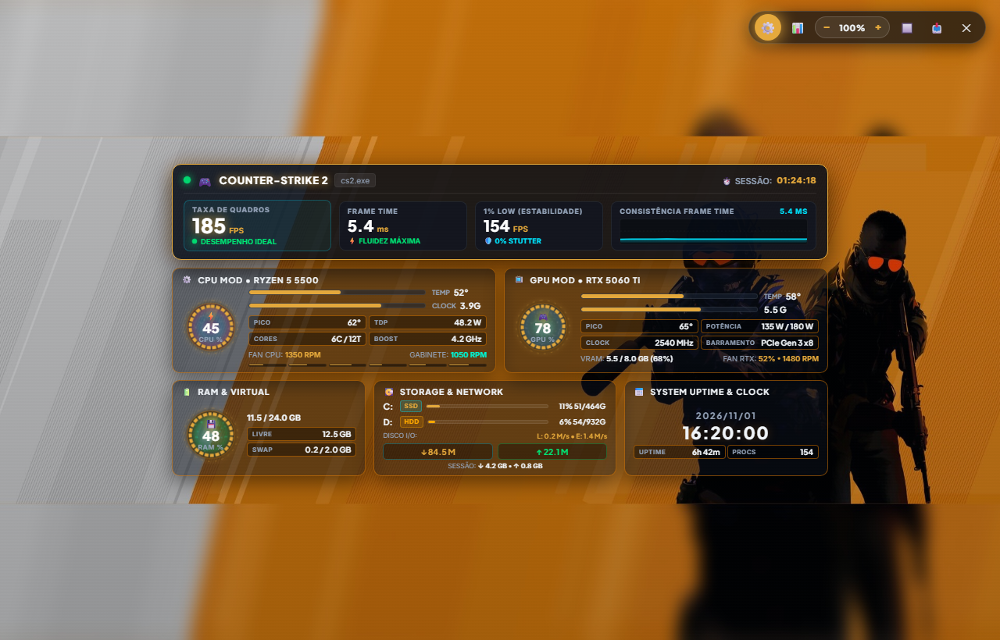
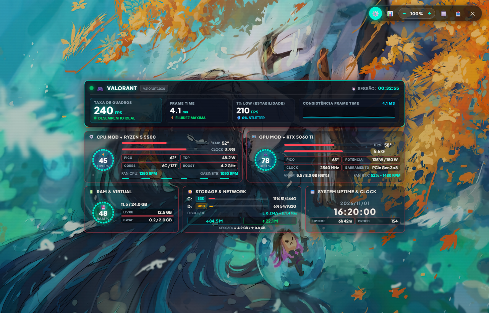
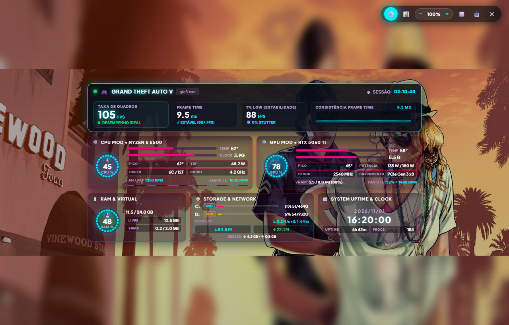
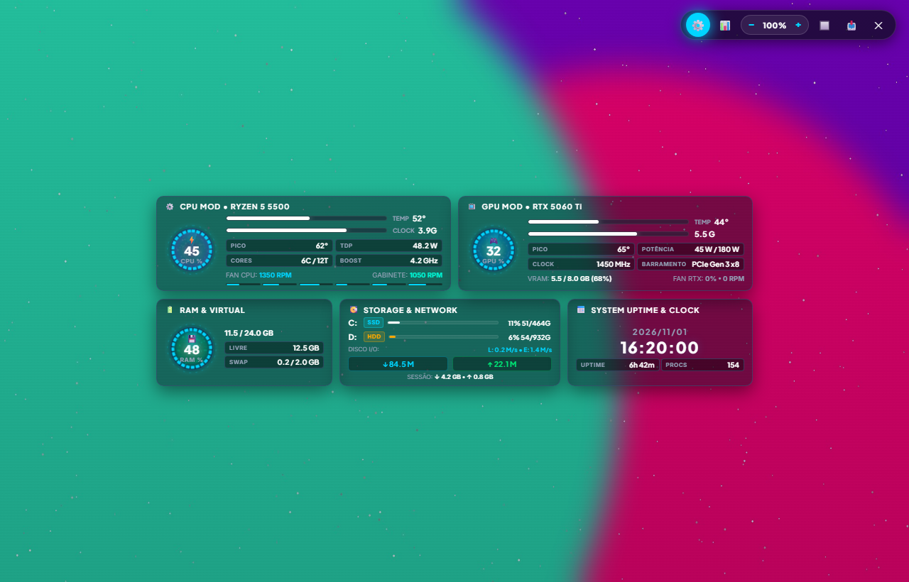

# ⚡ Aegis Gaming HUD & RTX Fan Controller

<p align="center">
  
</p>

<p align="center">
  
  
  
  
  
</p>

---

## 🚀 Visão Geral

O **Aegis Gaming HUD & RTX Fan Controller** é uma aplicação completa de telemetria em tempo real, controle térmico de hardware e painel sensor (*SensorPanel*) gamer em tela cheia borderless, projetado tanto para monitores principais quanto para **telas LCD secundárias embutidas no gabinete** (displays de 3.5", 5", 7", etc.).

Construído com **Python 3.12 (64-bit)** e uma interface moderna acelerada por hardware via **PyWebView (Microsoft Edge WebView2 Chromium)** com efeitos *glassmorphism*, temas dinâmicos dos jogos mais populares e controles térmicos de alta precisão.

---

## 📸 Galeria de Temas & Demonstração Visual

| 💣 Counter-Strike 2 (Tático) | 🦾 Cyberpunk 2077 (Neon) |
| :---: | :---: |
|  |  |
| **🎯 Valorant (Radianite)** | **🌴 GTA V / Vice City (Pôr do Sol 80s)** |
|  |  |
| **📱 Turing LCD (SensorPanel Gabinete)** | |
|  | |

---

## ✨ Principais Funcionalidades

### 🎮 1. Temas Imersivos dos Jogos Mais Populares
A interface se adapta dinamicamente aos títulos mais jogados da atualidade, incluindo identidade visual, anéis giratórios HUD e efeitos visuais exclusivos:
- 💣 **Counter-Strike 2 (CS2)**: Laranja tático, poeira de combate e hazard stripes.
- 🎯 **Valorant**: Vermelho Radianite, ciano vibrante e geometria angular.
- ⚔️ **League of Legends (LoL)**: Ouro Hextech, azul arcano de Piltover e runas celestiais.
- 🌴 **GTA V / GTA VI (Vice City)**: Pôr do sol degradê anos 80, rosa choque e azul turquesa.
- 🪖 **Call of Duty: Warzone**: Verde fosfórico de visão noturna e grade topográfica militar.
- 🦹 **Fortnite (Battle Royale)**: Fenda cósmica roxa, azul da tempestade e ouro de Vitória Royale.
- ⛏️ **Minecraft**: Blocos de Netherite com circuitos ativos de Redstone, Diamante e Esmeralda.
- 💍 **Elden Ring**: Ouro místico da Térvore (*Erdtree*) e brasas de Graça Perdida.
- 🦾 **Cyberpunk 2077**: Amarelo neon Samurai, vermelho Arasaka e glitches de Night City.
- 🏆 **Apex Legends**: Vermelho Apex Predator, grafite de titânio e energia de escudo.
- 📱 **Turing Classic & Supercar**: Visuais fiéis e futuristas para telas secundárias.

---

### 📊 2. Telemetria Completa de Hardware
- **Processador (CPU)**:
  - Uso geral (%) e frequência do clock em tempo real.
  - Temperatura ao vivo + **Pico Máximo de Temperatura (°C)** registrado na sessão.
  - Consumo estimado do pacote (Watts TDP).
  - Medidor individual por núcleo com mini-barras dinâmicas.
- **Placa de Vídeo (GPU - NVIDIA RTX)**:
  - Uso da GPU (%) e Temperatura com **Pico Máximo (°C)**.
  - Clocks em tempo real: Clock do Núcleo (MHz) e Memória VRAM (MHz).
  - Consumo elétrico (Watts atuais vs Limite de TDP).
  - Uso detalhado de VRAM (MB / GB e controlador de memória).
  - Rotação e velocidade real física das ventoinhas (%).
- **Armazenamento Multi-Disco (Todos os SSDs e HDDs)**:
  - Identificação automática de todas as unidades conectadas (`C:`, `D:`, `E:`, etc.).
  - Distinção visual inteligente entre **SSD** e **HDD**.
  - Porcentagem de uso, espaço utilizado e espaço livre em GB.
  - Taxa de transferência de Leitura e Escrita em tempo real (**I/O**).
- **Memória RAM & Arquivo de Paginação**:
  - RAM física (GB usados, total, percentual e memória livre).
  - Memória Virtual Swap / Pagefile ao vivo.
- **Rede & Tráfego de Dados**:
  - Velocidade instantânea de Download (`↓ M/s`) e Upload (`↑ M/s`).
  - Volume total transferido na sessão (`Down: GB • Up: GB`).
- **Sistema**:
  - Tempo de atividade do PC (*Uptime*) e total de processos ativos.
  - Relógio digital e data sincronizados.

---

### ❄️ 3. Controle Inteligente de Ventoinhas
- **Curva de Ventoinha Personalizada**: Ajuste pontos de temperatura vs velocidade em tempo real.
- **Zero RPM Inteligente**: Ventoinhas desligam automaticamente em temperaturas baixas para silêncio absoluto.
- **Histerese Anti-Ruído**: Evita que as ventoinhas fiquem acelerando e desacelerando repetidamente em variações curtas de temperatura.
- **Perfis Pré-configurados**: Silencioso, Equilibrado, Performance ou Manual fixo.

---

### 🛠️ 4. Otimizador do Windows & Debloater Integrados
- **Limpeza de Memória Cache (Standby RAM List)** com 1 clique.
- **Otimizações para Jogos**: Ativação do Modo de Jogo (*Game Mode*), Plano de Energia de Alto Desempenho e prioridade de GPU.
- **Debloater Nativo Offline**: Desativação de telemetria desnecessária, Cortana, Copilot e apps promocionais do Windows.

---

## ⌨️ Atalhos de Teclado & Controles

| Atalho / Ação | Função |
| :--- | :--- |
| **`F11`** | Alterna entre Tela Cheia 100% Borderless e Modo Janela |
| **`ESC`** | Sai do modo Tela Cheia |
| **`Ctrl` + `+`** ou **`Ctrl` + Roda do Mouse** | Aumenta o Zoom com escala vetorial nítida |
| **`Ctrl` + `-`** | Diminui o Zoom |
| **`Ctrl` + `0`** | Restaura o Zoom para 100% padrão |

---

## 📦 Como Executar

### Pré-requisitos
- **Windows 10 ou Windows 11 (64-bit)**
- **Python 3.12 (64-bit)**

### Passo a Passo
1. Clone este repositório ou baixe os arquivos:
   ```bash
   git clone https://github.com/tmesquita13/RTX_Fan_Controller.git
   cd RTX_Fan_Controller
   ```
2. Instale as dependências:
   ```bash
   pip install -r requirements.txt
   ```
3. Inicie o programa clicando duas vezes em:
   ```text
   Iniciar_Programa.bat
   ```
   *(O script solicitará privilégios de Administrador para liberar o controle das ventoinhas e sensores).*

---

## 📄 Licença

Distribuído sob a licença [MIT](LICENSE). Consulte `LICENSE` para mais informações.
